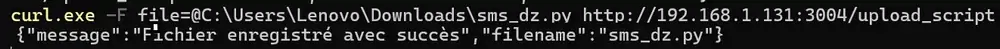

# Server node.js for API

This Node.js server allows you to:
  - Back up GladysAssistant databases
  - Restore backed-up databases
  - Upload executable scripts from Gladys

## Project Structure

project\
 ├─ server-api *fastify*/          # Code Fastify\
 │   ├─ index.js\
 │   ├─ package.json\
 ├─ python-service/  # API Python (container docker) \
 │   ├─ app.py\
 │   ├─ requirements.txt\
 ├─ lua   # Serveur LUA (Only Container Docker) \
 │   ├─ file.lua (file containing the Lua script)\
 ├─ scripts     External scripts (.py, .sh, .lua)\
 │   ├─ test.py\
 │   ├─ test.sh\
 │   ├─ main.lua\
 ├─ server-api-compose.yml
 

## Features
 
- [ ] http://<ip>:3004/backup_bd // to back up databases\
- [ ] curl.exe -F file=@C:<PATH>\<FILE> http://<IP de GLADYS>:3004//upload_script/<FILE>\
      // To upload a file (.py & .sh file for execution)\
   [ ] curl.exe -F file=@C:<PATH>\<FILE> http://<IP de GLADYS>:3004//upload_bd/<FILE>\
      // To upload a backup (backup db for restoration )\   
      
- [ ] http://<ip>:3004/restore_bd // to restore databases\
- [ ] http://<ip>:3004/script/<SCRIPT_NAME ARG1 ARG2...> // to run a script\
      // If an argument is composed of several words, it must be surrounded by quotation marks\
      // so that The shell considers it as a single argument.\
 - [ ] http://<ip>:3004/add_mod_py<MODULE PYTHON NAME> // to add a module to requirements.txt\
      // note: if the installation is done under Docker

## Installation & execution
**Important: The installation must be performed on the server hosting Gladys Assistant.**

  **Using Git**\
  *cd /opt*\
  *git clone https://github.com/mgrafr/server-api.git* \
  *cd server-api*
  *node index.js*

  **Downloading server-api from GitHub**\
  - *cd /opt*\
  - *wget "https:\/\/github.com/mgrafr/server-api/archive/refs/heads/main.zip"*
  - *unzip main.zip*
  - *mv server-api-main server-api*
  - 
  **Using Docker:**\
  - *docker pull ghcr.io/mgrafr/server-api:1.0.2 // github*
  - *docker pull ghcr.io/mgrafr/python-service:1.0.2 // github*\
   or at docker.io
  - *pull mgrafr/server-api:v8 // docker hub*
  - *pull mgrafr/python-service:v2 // docker hub*\
   execution:
  - *cd /opt/server-api*
  - *wget "https:\/\/github.com/mgrafr/server-api/blob/dev/server-api-compose.yml"*
  - *docker compose -f server-api-compose up-build -d*
  
# Using Gladys assistant

**en français:**
Ce serveur node js permet:\
  - de sauvegarder les bases de données de GladysAssistant\
  - de restaurer les bases de données sauvegardées\
  - de télécharger des scripts exécutable depuis Gladys
  - 
## Structure du projet

project\
 ├─ server-api *fastify*          # Code Fastify\
 │   ├─ server.js\
 │   ├─ package.json\
 ├─ python-service   # API Python (Conteneur Docker) \
 │   ├─ app.py\
 │   ├─ requirements.txt\
 ├─ lua   # Serveur LUA (Seulement Conteneur Docker) \
 │   ├─ file.lua    (fichier contenant le script lua)\
 ├─ scripts         Scripts externes (.py, .sh, .lua)\
 │   ├─ test.py\
 │   ├─ test.sh\
 │   ├─ main.lua\
 ├─ server-api-compose.yml
 
 ##  Fonctionnalités
 
 - [ ] http://<ip>:3004/backup_bd // pour sauvegarder les bases de données\
 - [ ] curl.exe -F file=@C:<PATH>\<FILE> http://<IP de GLADYS>:3004//upload_script/<FILE>\
     // Pour téléverser un fichier (fichier.py & sh pour exécution)
 - [ ] curl.exe -F file=@C:<PATH>\<FILE> http://<IP de GLADYS>:3004//upload_script/<FILE>\
      // Pour téléverser une sauvegarde (sauvegarde de BD pour restauration)\
 - [ ] http://<ip>:3004/restore_bd // pour restaurer les bases de données\
 - [ ] http://<ip>:3004/script/<NOM_SCRIPT ARG1 ARG2...> // pour exécuter un script\
       // si un argument est composé de plusieurs mots il faut l’entourer de guillemets pour que\
       // le shell le considère comme un seul argument.\
  - [ ] http://<ip>:3004/add_mod_py<NOM DU MODULE PYTHON> // pour ajouter un module à requirements.txt\
       // note : si l'installation est effectuée sous Docker
  
## Installation & exécution
 **importannt:l’installation doit être faite sur le serveur hebergeant Gladys assitant** \
 *Running Lua scripts is only possible after installing the "docker-lua" container*

**avec git**\
 *cd /opt*\
 *git clone https://github.com/mgrafr/server-api.git* \
 *cd server-api*\
 *node index.js // démarrage de server-api*
 
 **en téléchargent server-api depuis github**\
- *cd /opt*
- *wget "https:\/\/github.com/mgrafr/server-api/archive/refs/heads/main.zip"*
- *unzip main.zip*
- *mv server-api-main server-api*

 **avec Docker**\
- *docker pull ghcr.io/mgrafr/server-api:1.0.2 // github*
- *docker pull ghcr.io/mgrafr/python-service:1.0.2 // github*\
  ou chez docker.io
- *pull mgrafr/server-api:v8 // docker hub*
- *pull mgrafr/python-service:v2 // docker hub*
- *cd /opt/server-api*
- *wget https:\/\/github.com/mgrafr/server-api/blob/dev/server-api-compose.yml*
- *docker compose -f server-api-compose up-build -d*
  
 # Utilisation avec Gladys assistant
 
