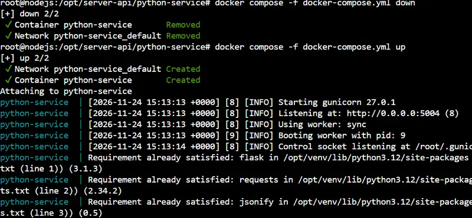

# python-service Dockerfile

## Includes 

- python:3.12-slim
- Gunicornluarocks 

## get this image

you can execute following command to get this docker image :

docker pull mgrafr/python-service:v4 # docker.io

ghcr.io pull mgrafr/python-service:1.0.4# github

## docker-compose/yml##

 

